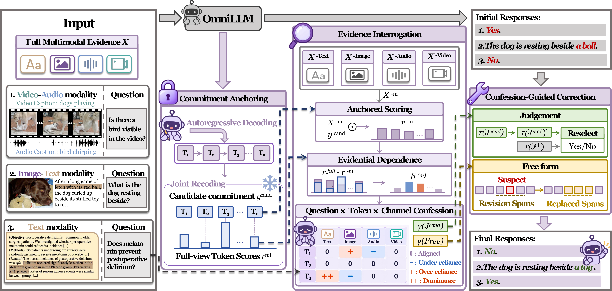

# OmniConfess

Official resources of **"OmniConfess: Counterfactual Channel Attribution for Multimodal Hallucination Correction"**. Anonymous. **Preprint 2026**.

## Overview



## Environment Setup

```bash
source scripts/env.sh
```

For an open-source install:

```bash
pip install -r requirements.txt
```

Model weights are loaded from `MMHALU_MODEL_ROOT` (default: Qwen2.5-Omni-7B).

## Quick Start

```bash
# PHD
$PY run_confess.py phd --output_dir outputs/omniconfess_phd

# CMM
$PY run_confess.py cmm --output_dir outputs/omniconfess_cmm

# PubMedQA
$PY run_confess.py pubmedqa --output_dir outputs/omniconfess_pubmedqa

# RAGTruth
$PY run_confess.py ragtruth --output_dir outputs/omniconfess_ragtruth

# HaloQuest (shardable across GPUs)
CUDA_VISIBLE_DEVICES=4,5,6,7 \
$PY run_confess.py haloquest \
    --halo_shard 0 --halo_nshards 4 \
    --output_dir outputs/omniconfess_haloquest

# AVHBench
$PY run_confess.py avhbench \
    --arm_paths a0.jsonl,a1.jsonl,a2.jsonl,a3.jsonl \
    --output_dir outputs/omniconfess_avhbench
```

`--dry_run` limits each job to the first few samples for a smoke test.

> For evaluation, please refer to the [evaluation](./evaluation/README.md) folder.

## BibTeX

```bibtex
@article{omniconfess2026,
  title   = {OmniConfess: Counterfactual Channel Attribution for Multimodal Hallucination Correction},
  author  = {Anonymous},
  journal = {Preprint},
  year    = {2026}
}
```
