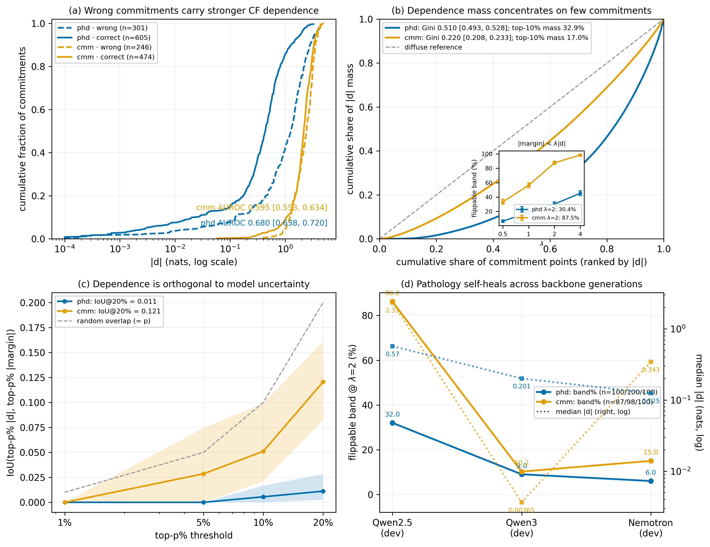

# OmniConfess: Counterfactual Channel Attribution for Multimodal Hallucination Correction

> *When a model says something it cannot actually see, hear, or read — it should confess.*

**OmniConfess** is a training-free, six-dataset **unified three-stage counterfactual confession** method for hallucination correction. A single spine detects and corrects ungrounded content across text, audio, video, and image tasks by asking, for every claim: *would the model still assert this if the relevant evidence were removed?* If yes, the claim is a parametric prior dressed up as an observation — and the confession signal is used to correct or suppress it.

---

## Overview



<!-- placeholder figure, to be replaced -->

Language models hallucinate because they conflate two sources of confidence: what the input evidence genuinely supports, and what their parameters already believed before looking. OmniConfess makes that distinction explicit and measurable through counterfactual channel ablation, then decides from the relevant evidence alone. The mechanism is not a critic, a verifier, or a second model — it is the same model, asked to reveal the gap between what it said and what the evidence warranted.

The method obeys four hard constraints:

1. **Training-free.** Inference-only — no weight updates, no fine-tuning, no LoRA.
2. **GT never enters the loop.** Ground truth is used only for offline metric computation; it never influences generation, localization, verification, or the accept/reject decision.
3. **Correction from evidence grounding.** Every accepted edit has a traceable reason — which channel, what counterfactual delta, which decision rule. Generic self-refinement does not qualify.
4. **No metric gaming.** The evaluation cohort and metric are fixed before any run and never adjusted post-hoc.

---

## The Three-Stage Framework

The three-stage spine is identical for every dataset — only the **ablated channel** and the **Stage-3 decision rule** change.

| Stage | What happens |
|---|---|
| **1 Generate** | Greedy decode under the full input view until the model commits to its answer (decision token for judgement tasks; per-content-word position for free-form generation). |
| **2 Confess** | Teacher-force one or more counterfactual (ablated) views on the same prefix; read how much each channel actually moved the answer. Every sample that reaches the commit point confesses unconditionally. |
| **3 Decide** | Map the full-view signal and the confession signal to a decision — force a token (judgement tasks) or emit corrected text (free-form tasks). Accept a correction only when the evidence supports it. |

For a decision *d* and a channel (modality) *m*:

```
κ_d^(m)  =  F_d(X) − F_d(X^{−m})     # how much channel m moves decision d
E_d^R    =  Σ_{m ∈ R} κ_d^(m)        # sum over the relevant channels only
decision =  argmax_d  E_d^R          # decide from relevant evidence alone
```

---

## Dataset Instantiations

| Dataset | Ablated channel | Stage-3 rule |
|---|---|---|
| **phd** | text context | gamma extrapolation on the yes/no margin |
| **cmm** | audio- and video-masked views | dual-channel grounding gate |
| **pubmedqa** | passage | candidate-anchored maybe-gate |
| **ragtruth** | passage (per content word) | temperate re-rank with fluency guards |
| **haloquest** | image | bucket-routed span correction (VC regen / FP pool / IC keep) |
| **avhbench** | four cross-arm views | majority vote-SC |

---

## Environment Setup

Dependencies and interpreter are wired by [`scripts/env.sh`](scripts/env.sh); the portable, publishable dependency spec is pinned in [`requirements.txt`](requirements.txt) (Python 3.10+, `torch==2.6.0`, `transformers>=4.52.0`).

```bash
cd <repo-root>
source scripts/env.sh          # sets $PY, PYTHONPATH, offline flags, CUDA
```

For an open-source install without the local tmpfs wiring:

```bash
pip install -r requirements.txt
```

Model weights are expected under `MMHALU_MODEL_ROOT` (default Qwen2.5-Omni-7B).

---

## Quick Start

The unified entry point `run_confess.py` dispatches all six datasets into the core library `omniconfess/` (equivalent to the legacy `confession/omniconfess_all.py`). Each dataset reads `OmniHalluBench/<ds>/annotations/<ds>.json` by default.

```bash
# phd — judgement task (text-context ablation, gamma decision)
$PY run_confess.py phd \
    --data_path OmniHalluBench/phd/annotations/phd.json \
    --output_dir outputs/omniconfess_phd

# cmm — audio/video dual-channel grounding gate
$PY run_confess.py cmm \
    --output_dir outputs/omniconfess_cmm

# pubmedqa — 3-class passage-ablation maybe-gate
$PY run_confess.py pubmedqa \
    --output_dir outputs/omniconfess_pubmedqa

# ragtruth — free-form passage re-rank with fluency guards
$PY run_confess.py ragtruth \
    --output_dir outputs/omniconfess_ragtruth

# haloquest — free-text image-ablation arm, shardable across GPUs
$PY run_confess.py haloquest \
    --halo_shard 0 --halo_nshards 8 \
    --output_dir outputs/omniconfess_haloquest

# avhbench — Stage-3 vote across four pre-generated arm files
$PY run_confess.py avhbench \
    --arm_paths a0.jsonl,a1.jsonl,a2.jsonl,a3.jsonl \
    --output_dir outputs/omniconfess_avhbench
```

Every subcommand accepts `--dry_run` (first few samples) for a quick smoke test:

```bash
$PY run_confess.py pubmedqa --dry_run
```

Run `$PY run_confess.py --help` for the full per-dataset flag list.

---

## Repository Layout

```
web-app/
├── run_confess.py            # unified six-dataset entry point
├── omniconfess/              # core library (≡ legacy confession/omniconfess_all.py)
│   ├── spine/                #   three-stage backbone (binary + free-form)
│   ├── operators/            #   Stage-3 decision rules (gamma / grounding / rerank / vote)
│   ├── datasets/             #   per-dataset drivers & channel ablations
│   └── backbone/             #   model loading, prompting, data utilities
├── evaluation/               # reproduction: scoring & metrics (see evaluation/README.md)
├── OmniHalluBench/           # benchmark data — annotations/<ds>.json + media/
│   ├── phd/  cmm/  pubmedqa/  ragtruth/  haloquest/  avhbench/
├── OmniConfess/              # paper baseline / comparison suite
├── scripts/                  # env.sh and batch runners
├── figs/                     # figures (framework.png, ...)
├── requirements.txt
└── README.md
```

---

## Evaluation

Scoring scripts and reproduction instructions live in [`evaluation/README.md`](evaluation/README.md).

---

## BibTeX

```bibtex
@article{omniconfess2026,
  title   = {OmniConfess: Counterfactual Channel Attribution for Multimodal Hallucination Correction},
  author  = {Anonymous},
  journal = {Preprint},
  year    = {2026}
}
```
